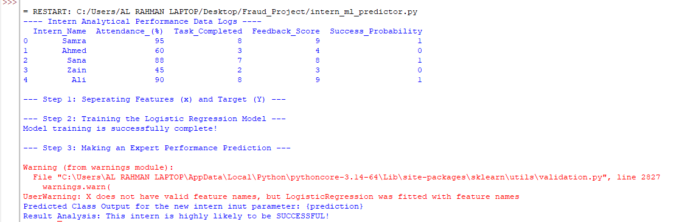

# Intern Performance Prediction Using Machine Learning

## Objective
This project builds a classification model to estimate internship performance from selected indicators such as attendance, task submissions, and feedback scores.

## Tools
- Python
- Pandas
- NumPy
- Scikit-learn
- Logistic Regression

## Method
The data is organised and prepared using Pandas. Selected performance-related features are used as inputs for a Logistic Regression classification model. The model is trained to classify the available records according to the defined performance categories.

## Result
The project generates predicted performance categories for the provided records. The predictions are intended for learning and analysis and should not be treated as final decisions about an individual’s performance.

